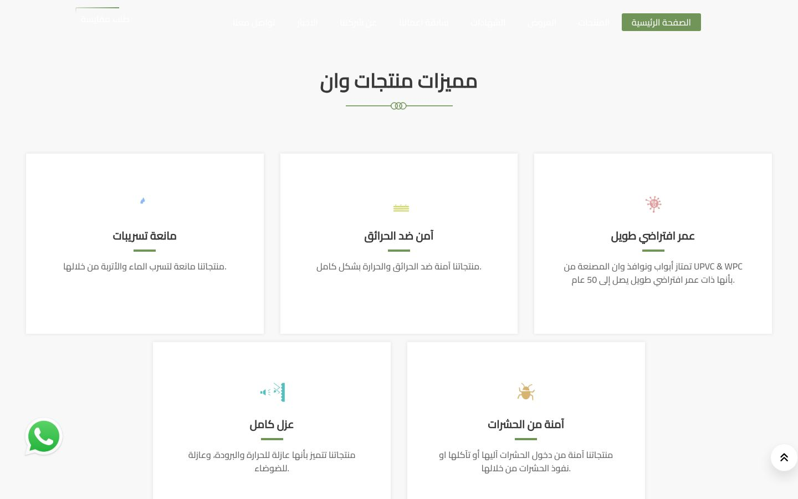
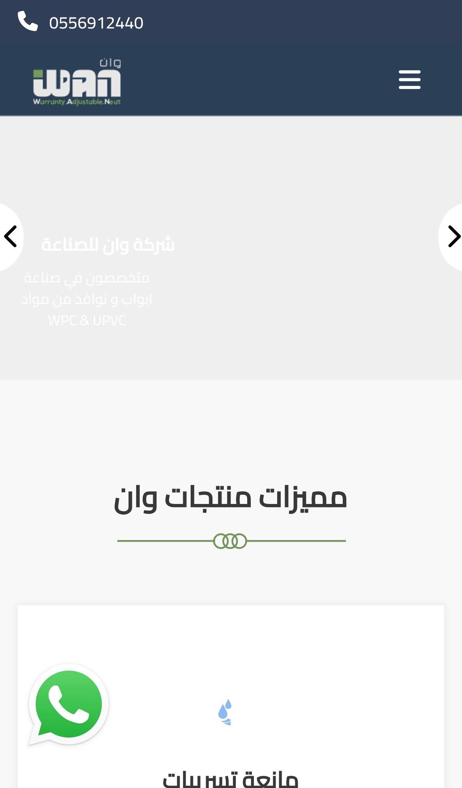
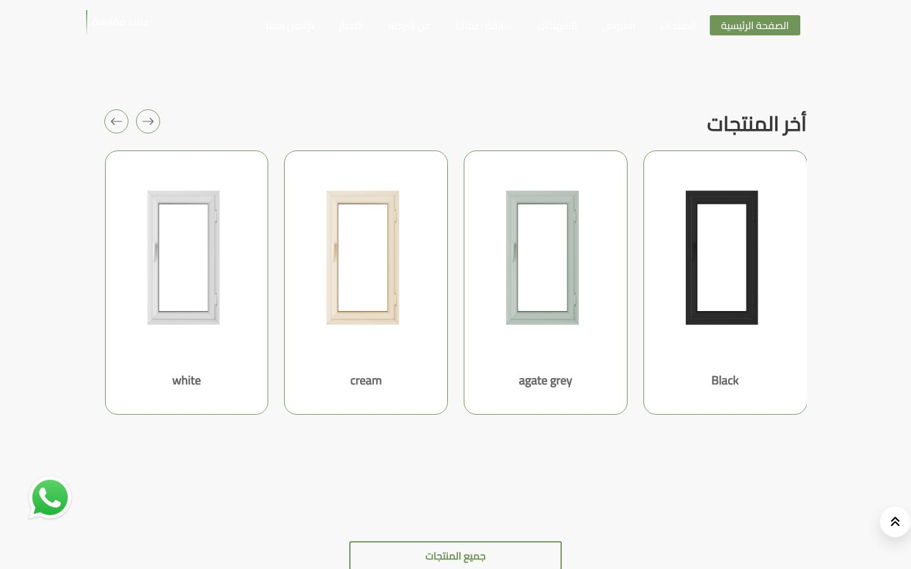

<div align="center">

# Wan Factory

### Arabic (RTL) home page for Wan, a UPVC and WPC doors and windows factory in Riyadh

شركة وان للصناعة: a right-to-left Bootstrap company home page with a video hero slider, product features, a product carousel, news cards, a WhatsApp button and a quote-request call to action.

[](https://developer.mozilla.org/docs/Web/HTML)
[](https://developer.mozilla.org/docs/Web/CSS)
[](https://developer.mozilla.org/docs/Web/JavaScript)
[](https://getbootstrap.com)
[](https://jquery.com)
[-2E7D32)](#overview)
<br>
[](https://dynamic-alfajores-57a532.netlify.app/)

**[Demo (Netlify)](https://dynamic-alfajores-57a532.netlify.app/)** ·
**[Portfolio](https://new-portfolio-ashy-xi.vercel.app/)** ·
**[LinkedIn](https://www.linkedin.com/in/eslamraafat-dev/)** ·
**[Email](mailto:eslamraafat736@gmail.com)**

<br>



</div>

<table>
  <tr>
    <td width="33%"></td>
    <td width="67%" valign="top"></td>
  </tr>
  <tr>
    <td align="center"><sub>Mobile (iPhone 13)</sub></td>
    <td align="center"><sub>Latest products carousel</sub></td>
  </tr>
</table>

> [!NOTE]
> The page loads its CSS, JavaScript and images from the client's domain, `wan-factory.com`, which is currently offline, so the Netlify demo shows unstyled HTML. The screenshots above were rendered from this repository's own copies of those files (`assets/` and `storage/`). The hero background video is not in the repo, so it is not shown.

---

## Overview

**Client project**, built through [Cord Digital](https://corddigital.com/), the digital agency I did client work with (it is credited in the footer). Wan (شركة وان للصناعة) is a Saudi company in Riyadh that manufactures doors and windows from UPVC and WPC. This repository holds the front end of the **Arabic home page** as one static file, `index.html`, built on a Bootstrap theme with a dedicated right-to-left stylesheet (`app-rtl.css`).

The other menu items (products, offers, certificates, previous work, about, news, contact, quote request) link to pages on the client's site and are not part of this repo.

## Features

- **Arabic RTL layout:** right-to-left stylesheet (`assets/frontend/css/app-rtl.css`) and Arabic copy throughout.
- **Header:** top bar with phone, email and social links (Facebook, X, WhatsApp, Instagram), a navbar with a highlighted "request a quote" button, and a separate slide-in mobile menu.
- **Hero slider (Owl Carousel):** a muted autoplay video slide with the company name and tagline, plus image slides for doors and windows.
- **Product features:** five cards with animated icons (leak-proof, fire-safe, long life of up to 50 years, heat and noise insulation, insect-proof).
- **About section** on a parallax background image.
- **Latest products carousel:** six frame colours (dark grey, dark brown, white, cream, agate grey, black) with prev / next arrows and an "all products" link.
- **Call to action:** "request a free quote" band.
- **Latest news:** six article cards with dates, linking to posts on the client's site.
- **Footer:** about text, quick links, address in Riyadh, contact details and a floating WhatsApp button plus back-to-top.

## Tech stack

| Layer | Tools |
| --- | --- |
| Markup | HTML5 (single page, `index.html`) |
| Styling | Bootstrap 4.1.1 (theme build), `app-rtl.css` (RTL theme), `theme-default.css` (colour theme), Animate.css |
| Icons | Font Awesome (theme bundle + 6.5.1 from CDN), Flaticon, Material Design Icons |
| Scripting | jQuery, Popper.js, Bootstrap JS, theme scripts (`app.js`, `middle.js`) |
| Plugins | Owl Carousel (theme copy + 2.3.4 from CDN), Slick, Magnific Popup, Isotope, imagesLoaded, Headroom, jQuery Countdown, ColorNip, ScrollReveal, Toastr |
| Hosting | Netlify (demo); the production site ran on the client's domain |

## Project structure

```text
.
├── index.html                      # Arabic RTL home page
├── assets/
│   ├── frontend/
│   │   ├── css/app-rtl.css         # main RTL theme stylesheet
│   │   ├── css/theme-color/        # colour theme
│   │   ├── js/app.js, middle.js    # theme scripts: sliders, menus, sticky header
│   │   ├── dependencies/           # bootstrap, jquery, owl.carousel, slick, magnific-popup, fonts and icons
│   │   ├── img/                    # logo and about image
│   │   └── media/                  # hero video poster image
│   └── media/                      # banner decoration
├── storage/                        # slider, product, feature-icon and news images
└── docs/screenshots/               # images used in this README
```

## Getting started

There is nothing to build:

```bash
git clone https://github.com/Eslamraafat1/Wan-Factory.git
cd Wan-Factory
npx serve .
```

`index.html` references its CSS, JS and images with absolute `https://wan-factory.com/...` URLs. While that domain is offline the page renders unstyled. To preview it locally, replace `https://wan-factory.com/` with `./` in a copy of `index.html`: the referenced files are in this repo (only the hero video is missing).

## Deployment

A demo copy is hosted on **Netlify**: [dynamic-alfajores-57a532.netlify.app](https://dynamic-alfajores-57a532.netlify.app/). It depends on `wan-factory.com` for its assets (see the note above).

## Author

**Eslam Raafat**, Front-End Developer (React · Next.js · TypeScript)

- **Portfolio:** [new-portfolio-ashy-xi.vercel.app](https://new-portfolio-ashy-xi.vercel.app/)
- **LinkedIn:** [linkedin.com/in/eslamraafat-dev](https://www.linkedin.com/in/eslamraafat-dev/)
- **GitHub:** [@Eslamraafat1](https://github.com/Eslamraafat1)
- **Email:** [eslamraafat736@gmail.com](mailto:eslamraafat736@gmail.com)

---

© Wan (شركة وان للصناعة). Code shared for portfolio purposes.
